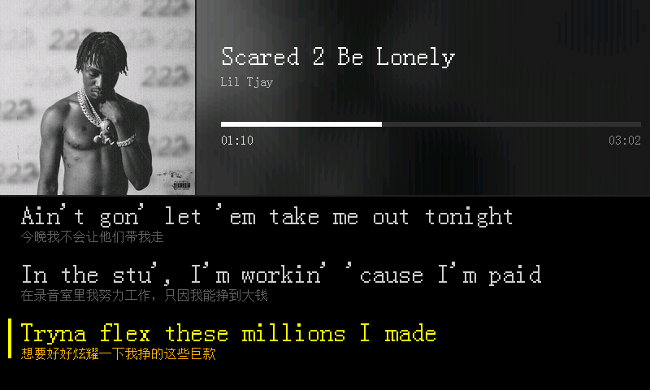
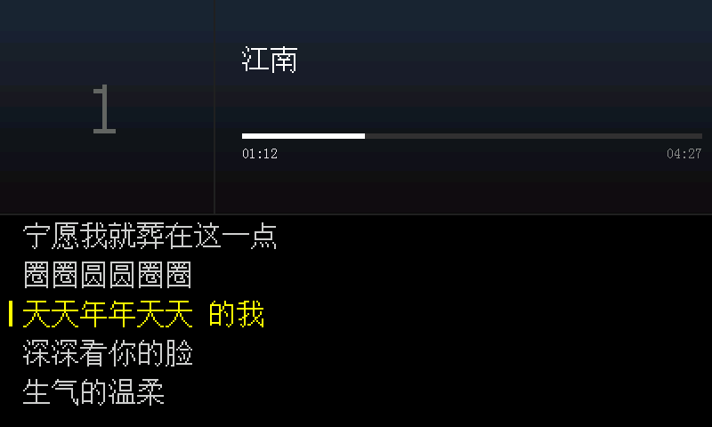

# LCD 播放界面：上半屏封面 + 下半屏双语歌词（实施说明）

> 2026-11-14。为「Scared 2 Be Lonely - Lil Tjay」加入第 5 首：
> MP3 → WAV、LRC → 歌词表、照片 → 封面点阵，屏上改成「上半屏图片 + 下半屏歌词」。
> 烧录前可先用 `Tools/preview_ui.py` 在电脑上看 1:1 效果图。

| 第 5 首（有封面，双语歌词） | 第 1 首（无封面，纯中文） |
|---|---|
|  |  |

> 两张图由 `Tools/preview_ui.py` 直接读固件里的点阵/像素数据渲染，不是设计稿。

---

## 1. 版式（800×480 横屏）

```
 y=0   ┌────────────┬──────────────────────────────────────────────┐
       │            │  Scared 2 Be Lonely        ← 歌名 32px 白字   │
       │  封面       │  Lil Tjay                  ← 歌手 16px 浅灰  │
       │ 240×240    │  ████████████░░░░░░░░░░░░  ← 进度条           │
       │  (照片)     │  01:10                 03:02 ← 已播/总长    │
 y=239 └────────────┴──────────────────────────────────────────────┘
 y=240 ───────────────── (2px 分隔线) ──────────────────────────────
       │ ▌In the stu', I'm workin' 'cause I'm paid    ← 原文 32px   │
       │   在录音室里我努力工作，只因我能挣到大钱      ← 译文 16px   │
       │                                                             │
       │ ▌Tryna flex these millions I made            ← 当前条高亮   │
       │   想要好好炫耀一下我挣的这些巨款                             │
       │                                                             │
       │  Phone ringin', niggas wanna talk                            │
       │   电话又响了，有人想要和我联系一下                           │
 y=479 └─────────────────────────────────────────────────────────────┘
```

| 常量（`lcd_ui.c`） | 值 | 说明 |
|---|---|---|
| `TOP_H` | 240 | 上半屏高度 = 封面边长 |
| `PANEL_X` / `PANEL_R` | 272 / 788 | 右侧文字区左右边界 |
| `TITLE_Y` / `ARTIST_Y` | 52 / 92 | 歌名 32px、歌手 16px |
| `BAR_X/Y/W/H` | 272 / 150 / 480 / 6 | 进度条 |
| `TIME_Y` | 164 | `mm:ss`，左已播、右总长 |
| `LYR_Y0` / `LYR_Y1` | 248 / 472 | 歌词区（224px 可用） |
| `BLK_STEP_BI` | 72 | 双语块步距（原文 32 + 4 + 译文 16 + 20 间隔）→ 3 块 |
| `BLK_STEP_MONO` | 44 | 单语块步距 → 5 块 |

配色：当前条原文黄 `0xFFE0`、译文暖橙 `0xFDA0`；其余原文亮灰 `0xCE79`、译文暗灰 `0x632C`。

---

## 2. 数据从哪来（全部脚本生成，不手写点阵）

```
          ┌─ Tools/pl05.wav ────────► 时长 s_durN（进度条用）
mp3 ──────┤
          └─ ffmpeg -ar 44100 -ac 2 -acodec pcm_s16le

lrc ──────► Tools/lrc_playlist.py ──► User/Hardware/LCD/lrc_data.h
              ├─ s_titleN / s_artistN（GBK 转义）
              ├─ s_durN（按 Tools/plNN.wav 字节数 ÷ 176400 算）
              └─ s_lrcN：`[mm:ss.xx]原文\x01译文\n`（同时间戳两行自动配对）

jpg ──────► Tools/gen_cover.py ─────► User/Hardware/LCD/cover_img.h
              ├─ s_coverN[240*240] RGB565 封面（居中裁方 + Lanczos）
              └─ s_bgN[400*120]    上半屏模糊底（强模糊 + 压暗 + 右侧渐隐）

上面三个头文件 ──► Tools/gen_cn_font.py ──► cn_font.h（只渲染用到的汉字）
                 Tools/preview_ui.py  ──► preview_song5.png（1:1 预览图）
```

### 加歌标准流程（换歌/加歌照做）

```bat
:: 1) 音频：任意采样率 -> 44.1k/16bit/立体声（顺序号必须与歌词一致）
ffmpeg -y -i "歌.mp3" -ar 44100 -ac 2 -acodec pcm_s16le Tools\pl05.wav

:: 2) 歌词：放进 Tools\lyrics\plNN.lrc（建议带 [ti:] [ar:] 标签）
:: 3) 封面（可选）：--song 必须等于曲目序号
py Tools\gen_cover.py "封面.jpg" --song 5

:: 4) 生成歌词表 + 同步字库用字
py Tools\lrc_playlist.py Tools\lyrics\pl01.lrc ... Tools\lyrics\pl05.lrc
py Tools\gen_cn_font.py

:: 5) 三重校验 + 体积
py Tools\check_font.py      :: 必须「缺字: 无」
py Tools\check_lrc.py       :: 必须「空正文 0」
py Tools\build_check.py --microlib

:: 6) 预览（可选，强烈建议）
py Tools\preview_ui.py --song 5 --time 01:10
```

> `MAX_SONGS`（lrc_playlist.py）、`SONG_COUNT`（lcd_ui.c）要一起改；
> `SONG_COUNT` 变了还要在 `s_lrcs/s_titles/s_artists/s_durs/s_covers/s_bgs` 六张表里补一项。

---

## 3. 代码改动清单

| 文件 | 改动 |
|---|---|
| `Tools/lrc_playlist.py` | 重写：`MAX_SONGS=5`；**同时间戳两行合并**成 `原文\x01译文`；`[ti:]/[ar:]` 标签优先于文件名；输出 `s_artistN`/`s_durN`；按 GBK 字节安全截断到 95 字节 |
| `Tools/gen_cover.py` | 新增：jpg → `s_coverN`(240×240) + `s_bgN`(400×120)，带抖动防色带、右侧渐隐给文字让对比度 |
| `Tools/preview_ui.py` | 新增：用固件里的同一批点阵/像素数据 + 同一套版式常量，渲染 800×480 PNG |
| `Tools/lrc_extract.py` | 新增：从 `lrc_data.h` 反推 `.lrc` 源文件（这次就是靠它把 4 首旧歌词救回 `Tools/lyrics/`） |
| `Tools/host_cdc_sender.py` | 新增 `--playlist`：自动按序号加载 `Tools/pl01..plNN.wav` |
| `User/Hardware/LCD/lcd.h` | `LCD_KEEP_ASCII_FONT` 0 → **1**（要显示英文歌名/歌手/时间；Keil 已授权，不再卡 32KB） |
| `User/Hardware/LCD/lcd_ui.c` | 整屏重写：封面/底图搬运、混排文字、进度条与时间、双语歌词块、歌词滚动、换曲重绘、上电默认曲目 |
| `User/Hardware/LCD/lrc_data.h` | 脚本重生成：5 首 + 歌手 + 时长 |
| `User/Hardware/LCD/cn_font.h` | 脚本重生成：505 → **655** 字 |
| `User/Hardware/LCD/cover_img.h` | 脚本新生成：封面 + 底图（约 206KB Flash） |

关键实现点：

1. **两套点阵方向不同，别抄错**
   - `cn_font.h`：**行优先**，每行 2 字节，MSB=最左 → `draw_glyph()`
   - `asc2_1608`：**逐列式**，每列 2 字节（上 8 行 / 下 8 行），MSB=最上 → `draw_ascii_ch()`
   两者都按整数 `scale` 放大，同一行/列的连续亮点合并成一次 `lcd_fill`。
2. **歌词只解析当前曲目**：5 首全解要 48KB RAM，改成换曲时重解析（一份 96 条 ≈ 9.6KB）。
   实测 RAM 从 72608B 降到 **58048B**。
3. **背景板只在 Flash 里存 400×120**，屏上由 `bg_px()` 双线性放大到 800×240；
   全屏铺底与「秒数刷新时擦掉时间文字」走**同一个 `bg_px()`**，所以擦多少补多少，像素完全对齐。
4. **歌词滚动用「固定格位」而不是居中**：当前块固定落在从上数第 3 格（首块序号 = 当前块 - 2，
   不足则从 0 开始），前面不够 3 块时从顶部排。这样开机没播放时也是满屏歌词，
   第一句开始唱时也不会整块跳动。
5. **进度条按像素增量重画**：只有 `want != s_bar_fill` 才写屏；时间只在秒变化时重写。

---

## 4. 预期现象

**开机（不接电脑）**——上电默认就停在第 5 首（`UI_DEFAULT_SONG=4`）

- 屏亮：上半屏左边是**那张封面照片**，右边深色模糊底上有 `Scared 2 Be Lonely` + `Lil Tjay`
  + 灰色进度条 + `00:00 / 03:02`
- 下半屏**满 3 块双语歌词**（6 行），无高亮（还没播）；串口（CH340，115200）打印
  `[6] LCD : id=0x5510 (NT35510=0x5510 / ILI9341=0x9341)`
- 开机画面见 `docs/img/preview_boot.png`

**接电脑放第 5 首**

```bat
py Tools\host_cdc_sender.py --auto --wait -f Tools\pl05.wav --gain 1.0
```

- 设备本来就是第 5 首，声音一进来歌词立刻高亮；要连播全部 5 首把 `-f ...` 换成 `--playlist`
- 0.4 秒后第一块变黄（左侧黄条）：
  上一行英文 `Too many lonely days, too many solo nights`（黄）
  下一行中文 `太多的孤单时日，太多夜晚独自度过`（橙）
- 每过一句整体上滚一格；进度条随 Pcm 匀速右移，右边时间从 `00:00` 走到 `03:02`
- 曲间切换时封面/歌名/歌词一起换，时间归零，**不会出现上一首的歌词残留**

---

## 5. 排查清单

| 现象 | 先查 |
|---|---|
| 上半屏全黑，下半屏正常 | `cover_img.h` 是否参与编译（在 `lcd_ui.c` 里 `#include`）；`s_covers[4]` 是否指向 `s_cover5` |
| 封面糊成色块 / 花屏 | F407 的 RGB565 是 **大端高字节在前？→ 本项目按 16bit 直接写 GRAM**，若颜色反了说明面板要 `0xFFFF-color`（本板 NT35510 不需要） |
| 歌名显示成方块 | `LCD_KEEP_ASCII_FONT` 是否已改 1；`extern const unsigned char asc2_1608[95][16]` 是否漏掉 |
| 英文歌词不显示/只有中文 | 同上，ASCII 字模没编进来时 `draw_ascii_ch` 会取到野指针（会 HardFault，不是静默） |
| 中文出现空方块 | `py Tools\check_font.py` 有「缺字」→ 重跑 `gen_cn_font.py`；新歌歌词没进 `DEMO_LYRICS` |
| 只有第一行歌词，之后不动 | `audio_stream_position_ms()` 没前进（没收到 PCM）；查上位机端口/`--gain`/脚本是否在发 |
| 歌词整块不换 | 换行判定用 `find_active()`；`check_lrc.py` 看时间戳是否升序、末行是否 00:00 |
| 切换歌但封面不变 | `SET_LINE_CODING` 只有 `100000<=baud<100016` 才切歌；`pl05.wav` 文件名末尾必须是 `05` |
| 进度条不动 / 总时长 00:00 | `s_durN` 为 0 → 生成时 `Tools/plNN.wav` 不存在；补给 wav 后重跑 `lrc_playlist.py` |
| 屏幕刷新时音频卡顿 | 不该发生：UI 只在主循环、限 10fps；若发生先查 `TICK_MS` 是否被改小 |

---

## 6. 容量（Keil V6.16 实跑，`Tools/keil_rebuild.bat` 全量 Rebuild）

```
Program Size: Code=27172 RO-data=247228 RW-data=536 ZI-data=57480
"..\..\Output\atk_f407.axf" - 0 Error(s), 0 Warning(s).
```

| 项 | 值 |
|---|---|
| Flash（Code+RO+RW） | **274936 B ≈ 268.5 KB** |
| RAM（RW+ZI） | **58016 B ≈ 56.7 KB** |
| 其中封面+底图 | 206.3 KB（Flash） |
| 汉字点阵 | 655 字 ≈ 20.5 KB |
| 歌词+标题+歌手+时长 | ≈ 11.5 KB |

F407ZGT6 有 1MB Flash / 128KB RAM，**每首歌再加一张封面（+206KB）也只到约 0.5MB**，
再放 3~4 张仍在容量内；RAM 只随歌词行数增长，与曲目数无关（歌词只解当前曲目）。
`Tools/build_check.py --microlib`（脚本内自建编译，不依赖 Keil 工程状态）报的数值与 Keil 相差不到 1KB，
属编译顺序/内联差异，两者同一数量级，都可用来卡容量。
